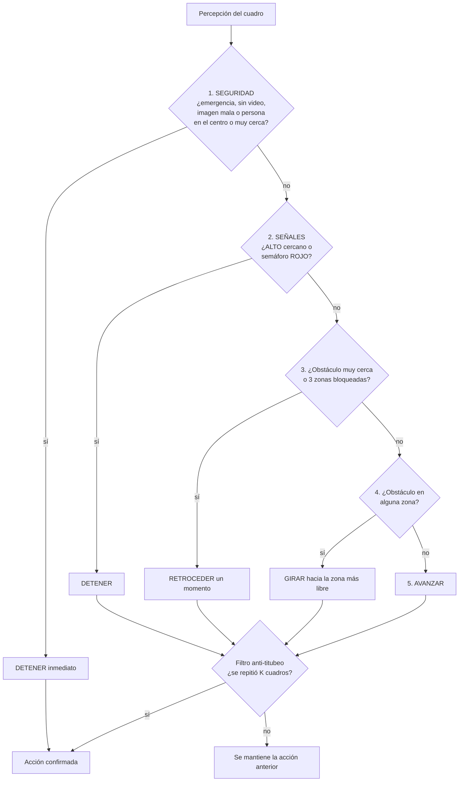
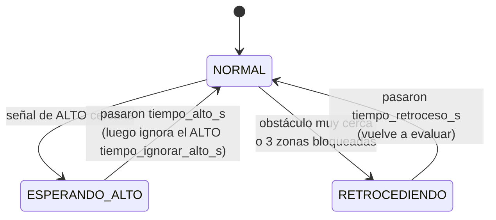

# Vehículo autónomo a escala: programa de la laptop

Un agente inteligente con el ciclo **Percibir → Razonar → Actuar**.
La ESP32-CAM transmite video y obedece comandos. **Todas las decisiones se toman en la laptop.**

```
 ESP32-CAM ──video MJPEG──►  LAPTOP  ──UDP "SEQ;COMANDO;VEL"──►  ESP32-CAM ──► L298N ──► motores
                              │  1. PERCIBIR  (YOLO + OpenCV)
                              │  2. RAZONAR   (reglas de prioridad + estados)
                              │  3. ACTUAR    (cliente UDP cada 100 ms)
 ESP32-CAM ◄────────────────── "ACK;SEQ" / "ERR;SEQ"  (se usa para medir latencia)
```

---

## 1. Estructura de archivos

| Archivo | Etapa | Qué hace |
|---|---|---|
| `main.py` | — | Programa principal: une todos los módulos en el ciclo del agente |
| `video.py` | Percibir | Lee video en un hilo y siempre entrega el cuadro más reciente |
| `percepcion_yolo.py` | Percibir | YOLO: clase, confianza, centro, zona y área de cada objeto |
| `percepcion_opencv.py` | Percibir | Color del semáforo (HSV), obstáculos por bordes, calidad de imagen |
| `decision.py` | Razonar | **Reglas de prioridad, máquina de estados y filtro anti-titubeo** |
| `comunicacion.py` | Actuar | Cliente UDP: envía comandos, recibe ACK y mide la latencia |
| `interfaz.py` | — | Dibuja video y panel, más las ventanas de calibración |
| `registro.py` | — | Guarda el CSV de métricas de cada recorrido |
| `configuracion.py` | — | Carga y guarda `config.json` |
| `analizar_metricas.py` | — | Resume un CSV para el reporte (y genera gráficas opcionales) |
| `config.json` | — | **Todos** los parámetros del sistema |

---

## 2. Instalación

Requiere **Python 3.10 a 3.12** (recomendado, porque PyTorch/Ultralytics siempre dan soporte primero a esas versiones).
No hace falta GPU: YOLO corre en CPU.

```bash
# 1) Crear y activar un entorno virtual
python -m venv venv
venv\Scripts\activate          # Windows
# source venv/bin/activate     # Linux / Mac

# 2) Instalar dependencias
pip install -r requirements.txt
```

La primera vez que se ejecute, Ultralytics descarga `yolov8n.pt` automáticamente (~6 MB).
Para usar YOLO11, cambia `"modelo": "yolo11n.pt"` en `config.json`.

> En Windows, si el comando `python` abre la Microsoft Store, usa `py` en su lugar (`py -m venv venv`).

---

## 3. Ejecución

| Comando | Para qué |
|---|---|
| `python main.py --webcam --sin-auto` | **Modo de prueba**: webcam, muestra todo y no envía comandos |
| `python main.py --webcam --sin-auto --calibrar` | Igual, con las ventanas de calibración abiertas |
| `python main.py --webcam --sin-auto --sin-yolo` | Solo OpenCV (útil si aún no se instala Ultralytics) |
| `python main.py` | Auto real con la IP de `config.json` |
| `python main.py --ip 192.168.1.50` | Auto real con otra IP |
| `python main.py --sin-registro` | No guardar el CSV |
| `python analizar_metricas.py` | Resumen del último recorrido |
| `python analizar_metricas.py registros/recorrido_X.csv --graficas` | Resumen de un archivo concreto, con gráficas PNG |

La URL del video se arma así: `http://<ip>:<puerto_stream><ruta_stream>` → `http://192.168.4.1:81/stream`.

### Controles

| Tecla | Acción |
|---|---|
| **ESPACIO** | Activa/desactiva el **paro de emergencia** (DETENER inmediato) |
| **P** | Pausa/reanuda el envío de comandos. Sirve para **probar el fail-safe**: el auto debe detenerse solo en 500 ms |
| **C** | Abre/cierra las ventanas de calibración |
| **G** | Guarda los valores actuales en `config.json` |
| **Q** | Sale enviando DETENER varias veces |

---

## 4. Cómo funciona

### 4.1 Percibir

1. **Video** (`video.py`): un hilo lee sin parar y guarda solo el último cuadro con su hora de llegada.
   Si no hay cuadro, o el último tiene más de `max_antiguedad_cuadro_s` (1 s), el agente se detiene.
2. **Calidad** (`evaluar_calidad`): brillo promedio bajo → *imagen muy oscura*. Varianza del Laplaciano baja → *imagen borrosa*. Las dos causan DETENER.
3. **YOLO** (`percepcion_yolo.py`): por cada objeto calcula
   - `cx` = centro horizontal / ancho (0 = izquierda, 1 = derecha)
   - `zona` = IZQ si `cx < 0.33`, DER si `cx > 0.66`, CENTRO en otro caso
   - `area` = área de la caja / área del cuadro → **mientras más grande, más cerca**
   - Corre cada `cada_n_cuadros` cuadros; entre medias reutiliza el último resultado.
4. **Semáforo** (`clasificar_semaforo`): recorta la caja de *traffic light*, pasa a HSV y cuenta píxeles rojos y verdes.
   El rojo usa **dos rangos** porque en OpenCV el matiz va de 0 a 179 y el rojo está en los dos extremos.
5. **Obstáculos sin YOLO** (`analizar_obstaculos`): región inferior → gris → desenfoque → Canny (o umbral Otsu) → dilatación → contornos rellenos.
   Para cada zona se calcula el **porcentaje ocupado**; si supera `umbral_ocupacion_zona`, la zona está bloqueada.

### 4.2 Razonar (`decision.py`)

**Reglas de prioridad**: la primera que se cumple decide la acción.



**Máquina de estados** (para las acciones que duran un tiempo):



**Zonas ocupadas (fusión)**: una zona está ocupada si YOLO ve ahí un obstáculo (o una persona a un lado) con área ≥ `area_obstaculo_zona`, **o** si OpenCV la marca como bloqueada.
Para elegir el giro se suma un "puntaje" por zona (áreas de YOLO + ocupación de OpenCV) y se gira hacia el lado con menos puntaje.

**Anti-titubeo**: una acción nueva debe repetirse `confirmaciones_k` cuadros seguidos. El DETENER de la regla 1 es la única excepción y se aplica de inmediato.
Mientras se confirma, el motivo en pantalla dice, por ejemplo, `Camino libre (confirmando GIRAR_IZQ 1/3)`.

Cada decisión guarda su **motivo** y el **número de regla**, que se ven en pantalla y se guardan en el CSV.

### 4.3 Actuar (`comunicacion.py`)

- Un hilo envía el comando actual **cada 100 ms aunque no cambie**: así se mantiene vivo el fail-safe de la ESP32 (si se dejan de recibir comandos por 500 ms, el auto se detiene).
- Cada mensaje lleva un número `SEQ`. Al recibir `ACK;SEQ` se calcula la latencia de ida y vuelta, que se muestra como promedio de las últimas 20 muestras.
- Contadores en pantalla: `Env` (enviados), `ACK`, `ERR` (comando inválido), `Perd` (sin ACK en `tiempo_max_espera_ack_s`).

---

## 5. Calibración

1. Ejecuta `python main.py --webcam --sin-auto --calibrar` (o presiona **C**).
2. **Ventana "Calibracion HSV (semaforo)"**: muestra en rojo/verde los píxeles de toda la imagen que caen en los rangos.
   Pon el semáforo frente a la cámara y mueve `H min/max`, `S min` y `V min` hasta que **solo la luz encendida** se pinte.
   - `R1` = rojo cerca de 0, `R2` = rojo cerca de 179.
   - `Prop min %` = porcentaje mínimo de la caja que debe tener color para decidir ROJO o VERDE.
3. **Ventana "Calibracion umbrales"**: muestra la máscara de obstáculos de la ROI.
   - Con el **piso vacío** delante, sube `Canny bajo/alto` o `Area min cont` hasta que la máscara quede casi negra.
   - Pon una caja delante y verifica que aparezca blanca y que la zona se marque OCUPADA.
   - `ROI inicio %`: dónde empieza la región de interés (60 = desde el 60 % de la altura hacia abajo).
   - `Ocupacion %`: porcentaje de la zona que debe estar ocupado para considerarla bloqueada.
   - `Brillo min`, `Nitidez min`: límites de imagen confiable (en el panel se ven los valores actuales).
   - `Conf YOLO %`: confianza mínima de YOLO.
4. Presiona **G** para guardar en `config.json`.

> Consejo: en el panel lateral se ven el brillo y la nitidez en vivo. Para escoger `nitidez_minima`, mueve la cámara rápido (imagen borrosa) y anota el valor; usa uno un poco mayor.

---

## 6. Parámetros de `config.json`

| Sección | Parámetro | Significado |
|---|---|---|
| `auto` | `ip`, `puerto_udp`, `puerto_stream`, `ruta_stream` | Dirección del auto |
| `video` | `indice_webcam` | Índice de la webcam USB (0) |
| | `ancho`, `alto` | Tamaño de trabajo (320×240) |
| | `max_antiguedad_cuadro_s` | Si el último cuadro es más viejo → DETENER |
| | `espera_reconexion_s`, `timeout_conexion_ms` | Reconexión del stream |
| `yolo` | `modelo`, `imgsz`, `confianza` | Modelo, tamaño de entrada, umbral |
| | `cada_n_cuadros` | 1 = YOLO en todos los cuadros; 2 = uno sí, uno no… |
| | `clases_persona`, `clases_senal_alto`, `clases_semaforo`, `clases_obstaculo` | Clases relevantes (nombres COCO) |
| `zonas` | `limite_izq`, `limite_der` | Límites de las zonas (0.33 y 0.66) |
| `semaforo` | `rojo1_*`, `rojo2_*`, `verde_*` | Rangos HSV `[H, S, V]` |
| | `proporcion_minima` | Fracción mínima de píxeles de color |
| `opencv_obstaculos` | `activado`, `metodo` (`canny` o `umbral`) | Respaldo de obstáculos |
| | `roi_inicio_y`, `desenfoque_kernel`, `canny_bajo`, `canny_alto`, `iteraciones_dilatacion`, `area_minima_contorno`, `umbral_ocupacion_zona` | Ajustes del procesamiento |
| `calidad_imagen` | `brillo_minimo`, `nitidez_minima` | Imagen no confiable → DETENER |
| `decision` | `area_persona_minima`, `area_persona_grande` | Persona: tamaño mínimo a considerar / "muy cerca" |
| | `area_senal_alto_cercana`, `tiempo_alto_s`, `tiempo_ignorar_alto_s` | Señal de alto |
| | `area_semaforo_minima` | Ignorar semáforos más pequeños (lejanos) |
| | `area_obstaculo_zona`, `area_obstaculo_muy_cercano`, `tiempo_retroceso_s` | Obstáculos |
| | `girar_por_obstaculo_lateral` | `true`: también esquiva obstáculos a los lados, no solo al centro |
| | `giro_preferido` | Giro si ambos lados están igual de libres |
| | `confirmaciones_k` | Cuadros para confirmar una acción nueva |
| `velocidades` | una por comando (0–255) | 0 = velocidad por defecto del firmware |
| `comunicacion` | `intervalo_envio_s`, `tiempo_max_espera_ack_s`, `repeticiones_detener_al_salir`, `muestras_promedio_latencia` | Cliente UDP |
| `interfaz` | `escala_video`, `ancho_panel` | Tamaño de la ventana |
| `registro` | `activado`, `carpeta` | CSV de métricas |

---

## 7. Métricas para el reporte

Cada ejecución crea `registros/recorrido_AAAAMMDD_HHMMSS.csv` con una fila por cuadro:
`tiempo_s, fps, latencia_ms, accion, motivo, regla, estado, emergencia, pausado, video_ok, brillo, nitidez, semaforo, yolo_ejecutado, num_detecciones, detecciones, ocup_izq/centro/der, zona_izq/centro/der`.

`python analizar_metricas.py` muestra: duración, FPS (promedio/mín/máx), latencia, conteo y porcentaje de cada acción, reglas activadas, cambios de acción, detecciones por clase y colores de semáforo vistos.
Las detecciones solo se cuentan en los cuadros donde YOLO realmente se ejecutó (`yolo_ejecutado = 1`), para no contar dos veces la misma.

---

## 8. Problemas comunes

| Síntoma | Causa probable / solución |
|---|---|
| "SIN VIDEO" con el auto | Revisa la IP y abre `http://IP:81/stream` en el navegador. La ESP32 solo admite **un cliente** de stream a la vez: cierra el navegador antes de ejecutar. |
| FPS muy bajos | Sube `cada_n_cuadros` a 2 o 3; verifica que `imgsz` sea 320. |
| Gira sin motivo | Piso con textura o reflejos: sube `canny_bajo/alto`, `area_minima_contorno` o `umbral_ocupacion_zona`. |
| Semáforo siempre DESCONOCIDO | Calibra HSV; baja `Prop min %`. |
| Se detiene por "Imagen borrosa" | Baja `nitidez_minima` (cada cámara da valores distintos). |
| Latencia "--" | No llegan ACK: revisa IP, puerto 4210 y el firewall de Windows (permitir Python en redes privadas). |
| Los textos en pantalla no llevan acentos | Es normal: OpenCV no puede dibujar á, é, ñ. En el CSV sí se guardan. |
