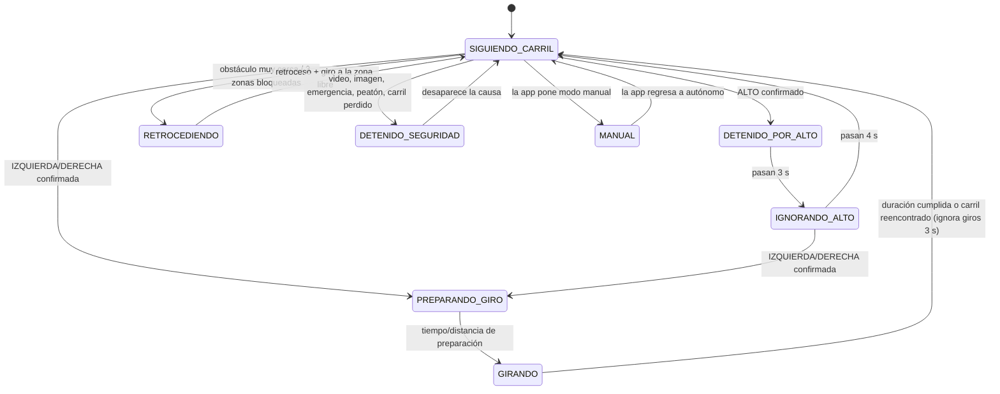

# VisionCar: carrito autónomo (programa de la laptop)

El carrito recorre solo una pista con carril (fondo oscuro, bordes blancos y línea central amarilla discontinua). El programa:

- sigue el carril,
- obedece 4 señales (alto, avanzar, izquierda y derecha),
- se detiene ante peatones,
- esquiva obstáculos o retrocede si los tiene muy cerca,
- y registra cada decisión en la nube (API de la carpeta `api/`).

Todas las decisiones se toman en la laptop. La ESP32-CAM transmite el video y obedece los comandos.

```
 ESP32-CAM ──video MJPEG──►  LAPTOP  ──UDP "CLAVE;SEQ;COMANDO;P1;P2"──►  carrito (firmware v2)
                              │  1. PERCIBIR  YOLO (personas/obstáculos) + modelo de señales + carril + OpenCV
                              │  2. RAZONAR   máquina de estados con prioridades
                              │  3. ACTUAR    comando UDP cada 100 ms
                              │  4. NUBE      eventos ──HTTPS──► API  ◄── control manual (app)
 carrito  ───────────────────► "ACK;SEQ"  (sirve para medir la latencia)
```

---

## 1. Archivos

| Archivo | Etapa | Qué hace |
|---|---|---|
| `main.py` | — | Programa principal: une todos los módulos en el ciclo del agente |
| `video.py` | Percibir | Lee el video en un hilo y siempre entrega el cuadro más reciente (stream, webcam o archivo) |
| `percepcion_yolo.py` | Percibir | YOLO COCO (personas y obstáculos) y modelo propio de señales (`modelo/best.pt`) |
| `carril.py` | Percibir | **Detección del carril** (HSV + Canny) y **control PD** de las ruedas |
| `percepcion_opencv.py` | Percibir | Calidad de imagen y obstáculos por bordes (sin contar las líneas del carril) |
| `decision.py` | Razonar | **Máquina de estados** con reglas de prioridad |
| `comunicacion.py` | Actuar | Cliente UDP del protocolo v2, ACK, latencia y vigilante |
| `nube.py` | Nube | Envía eventos a la API (cola + `pendientes.jsonl`) y consulta el control manual |
| `interfaz.py` | — | Pantalla y ventanas de calibración |
| `registro.py` | — | CSV de métricas de cada recorrido |
| `analizar_metricas.py` | — | Resumen de un CSV para el reporte |
| `prueba_10.py` | — | Registro de 10 pruebas por señal y porcentaje de éxito |
| `configuracion.py` | — | Carga y guarda `config.json` |
| `config.json` | — | **Todos** los tiempos, umbrales y velocidades |
| `modelo/best.pt` | — | Modelo de señales (cópialo aquí cuando esté entrenado) |
| `.env` | — | Token de la API (**no se sube a git**) |

---

## 2. Instalación

```bash
python -m venv venv
venv\Scripts\activate          # Windows
pip install -r requirements.txt
```

La nube no necesita paquetes extra (usa la biblioteca estándar de Python).

**Token de la API:** copia `.env.example` como `.env` y pon el valor de `TOKEN_CARRITO`, el mismo que está configurado en la API (Render).
La URL de la API está en `config.json → nube.api_url`. También se puede poner `API_URL=...` en `.env`.

**Modelo de señales:** copia el archivo entrenado como `modelo/best.pt`, con las clases `alto`, `avanzar`, `izquierda` y `derecha`.
Si tus clases tienen otros nombres, tradúcelas en `config.json → senales → clases`, por ejemplo `"stop": "alto"`.
**Mientras no exista**, el programa funciona igual: muestra *"sin modelo de senales"*, sigue el carril, detecta personas y obstáculos y registra `senal: "ninguna"`. El modelo se carga al iniciar el programa, así que después de copiarlo solo hay que volver a ejecutarlo.

---

## 3. Ejecución

| Comando | Para qué |
|---|---|
| `python main.py` | Carrito real (IP de `config.json`) con nube |
| `python main.py --sin-nube` | Carrito real, sin internet |
| `python main.py --webcam --sin-auto --sin-nube` | Prueba con la webcam, sin enviar comandos |
| `python main.py --video pista.mp4 --sin-auto --sin-nube` | Prueba con una grabación (se repite al terminar) |
| `python main.py --webcam --sin-auto --calibrar` | Abre las ventanas de calibración |
| `python main.py --ip 172.20.10.5` | Usar otra IP del carrito |
| `python main.py --sin-yolo` | Sin YOLO COCO (sin personas ni obstáculos por YOLO) |
| `python analizar_metricas.py [--graficas]` | Resumen del último recorrido |
| `python prueba_10.py` | Pruebas de 10 intentos por señal |

Al arrancar, cada modelo YOLO hace una inferencia de "calentamiento" (unos segundos). Así el primer cuadro real no congela el ciclo.

### Teclas

| Tecla | Acción |
|---|---|
| **ESPACIO** | Paro de emergencia (activa/desactiva) |
| **Q** | Salir enviando DETENER varias veces |
| **P** | Pausar el envío UDP (prueba del fail-safe: el carrito debe frenar en 500 ms) |
| **C** | Abrir/cerrar la calibración |
| **G** | Guardar la configuración actual en `config.json` |

### En pantalla

El estado, el comando y su motivo, la señal vista con barra de confianza (y la señal confirmada), el carril detectado con barra de error, las tres zonas de obstáculos, la conexión a la nube y el modo de control, los eventos pendientes, los FPS, la latencia y los contadores UDP.
Sobre el video se dibujan la región del carril (amarillo = límite izquierdo, blanco = límite derecho, verde = centro), las cajas de YOLO y las zonas.

---

## 4. Protocolo del carrito (firmware v2)

`CLAVE;SEQ;COMANDO;P1;P2` por UDP al puerto 4210 de `172.20.10.3`, con la clave `visioncar7a`.

| Comando | Parámetros | Ejemplo |
|---|---|---|
| `AVANZAR`, `RETROCEDER`, `GIRAR_IZQ`, `GIRAR_DER` | vel 0-255 (0 = por defecto) | `visioncar7a;12;AVANZAR;160` |
| `DETENER` | — | `visioncar7a;13;DETENER` |
| `MOVER` | vel_izq, vel_der (-255 a 255) | `visioncar7a;14;MOVER;190;110` |

- `SEQ` empieza en 1 y siempre aumenta. El carrito responde `ACK;SEQ`, y con eso se calcula la latencia de ida y vuelta.
- El comando actual se **reenvía cada 100 ms** (el carrito se detiene solo si pasan 500 ms sin recibir nada).
- **Vigilante:** si el ciclo de visión se traba más de `max_sin_decision_s` (0.5 s), el hilo UDP manda DETENER en lugar de repetir el último comando.
- Si la clave está mal, el carrito no responde y en pantalla aparece *"Carrito no responde (IP o CLAVE?)"*.
- Si tu firmware exige siempre P1 y P2, pon `"rellenar_parametros": true` y se mandará `DETENER;0;0`.

---

## 5. Cómo decide

### 5.1 Prioridades (la primera que se cumple gana)

1. **Seguridad**, inmediata y sin confirmación: video perdido o con más de 1 s de antigüedad, imagen oscura o borrosa, paro de emergencia, persona en el carril → **DETENER**.
2. **Modo manual** desde la app (vía la API) → obedecer la acción manual.
3. **Señal confirmada** o maniobra en curso (alto, giros, avanzar).
4. **Obstáculo muy cercano** o las tres zonas bloqueadas → retroceder y luego girar hacia la zona más libre.
5. **Obstáculo en una zona** → girar hacia la zona más libre.
6. **Seguir el carril** (control PD → `MOVER`).

**Señal confirmada:** la misma clase aparece en **K de los últimos M** cuadros analizados (3 de 5), con confianza ≥ `umbral_confianza_senal` y con un área mayor que su `area_activacion`. El área de activación sirve para que la señal se obedezca cuando ya está cerca, no desde lejos.
Las detecciones de más de `ventana_confirmacion_s` (1.5 s) ya no cuentan, y las señales que se están ignorando no se acumulan.

**Persona en el carril:** su caja se cruza con el carril detectado (más un margen), o su área es mayor que `area_persona_grande`. Si no hay carril, se usa la zona central.

### 5.2 Máquina de estados



Desde **cualquier** estado se pasa a DETENIDO_SEGURIDAD (regla 1) o a MANUAL (regla 2). En ambos casos se cancela la maniobra en curso.

### 5.3 Seguimiento de carril (`carril.py`)

1. Región de interés: la parte inferior de la imagen (`roi_inicio_y`).
2. Máscaras: blanco (S baja, V alta), amarillo (H ≈ 15-38) y, si `metodo` es `"canny"` o `"ambos"`, bordes Canny.
3. La región se divide en `franjas`. En cada franja se busca la línea amarilla más cercana al centro anterior y el borde blanco a su lado. Si una franja no tiene amarilla (porque es discontinua), se usa el ancho de carril aprendido.
4. **error** = (centro del carril − centro deseado) / medio ancho de la imagen. Va de −1 a +1.
5. **PD:** `corrección = kp·error + kd·(Δerror/Δt)`, `vel_izq = base + corrección`, `vel_der = base − corrección` → `MOVER;vel_izq;vel_der`.
6. **Carril perdido:** durante `max_cuadros_sin_carril` cuadros mantiene el último comando. Después aplica `al_perder_carril`: `"buscar"` gira lento hacia donde se fue el carril (hasta `tiempo_max_busqueda_s`) y `"detener"` se queda quieto hasta reencontrarlo.

`carril_objetivo`: `"derecho"` (entre la amarilla y el borde derecho), `"izquierdo"` o `"completo"` (entre los dos bordes blancos).

### 5.4 Nube (`nube.py`)

- Se manda un evento en cada **cambio de acción o señal** y **cada 2 s**, con un mínimo de 0.25 s entre eventos para no saturar la API.
  Formato exacto: `{"carrito_id","fecha","senal","confianza","accion","modo"}`.
- El retroceso se registra como `"detener"`. La API rechaza campos extra, así que el motivo "retroceso" solo queda en el CSV local.
- **Sin internet:** los eventos van a `pendientes.jsonl` y se suben en lotes al volver la conexión (reintento cada 5 s). Los eventos que la API rechace por inválidos (422) van a `rechazados.jsonl`.
- **Control:** `GET /api/v1/control/{carrito_id}` cada 300 ms. Si `modo = "manual"`, el carrito obedece la acción. Si no hay respuesta en 1 s estando en manual, se detiene.
- Todo corre en hilos con cola: la nube **nunca** frena el ciclo de visión.

---

## 6. Calibración (`--calibrar` o tecla C)

**Ventana "Calibracion carril"**: muestra en blanco el borde detectado y en amarillo la línea central. Los puntos marcan el límite izquierdo (rojo), el derecho (azul) y el centro (verde).
1. Coloca el carrito centrado en su carril.
2. `ROI inicio %`: que la región cubra solo la pista cercana.
3. `Blanco V min` / `Blanco S max`: que los bordes blancos queden completos y el fondo negro.
4. `Amar H min/max`, `S min`, `V min`: que solo la línea amarilla se pinte de amarillo.
5. `Canny bajo/alto`: si hay reflejos, súbelos o usa `"metodo": "color"`.
6. Revisa en la ventana principal que el error sea ≈ 0 con el carrito centrado. Si la cámara no está centrada, ajusta `centro_objetivo` en `config.json`.
7. **Control PD:** empieza con `Kd = 0` y una `Vel base` baja. Sube `Kp` hasta que corrija sin zigzaguear, y luego sube `Kd` para amortiguar las oscilaciones.
8. Guarda con **G** o moviendo `GUARDAR (1)` a 1.

**Ventana "Calibracion obstaculos"**: con la pista vacía, la máscara debe quedar negra. Si no, sube `Canny`, `Area min cont` u `Ocupacion %`. Ahí también se ajustan `Brillo min`, `Nitidez min` (una pista oscura puede pasar por "imagen oscura") y `Conf YOLO %`.

**Señales (en `config.json`)**: pon la señal a la distancia a la que quieres que reaccione y observa el % de área que aparece junto a su caja. Usa ese valor como `area_activacion` de esa clase. Calibra `giro_izquierda` / `giro_derecha` ([vel_izq, vel_der]), `duracion_giro_s` y `preparacion_tiempo_s` en la intersección real.
Para usar distancia en lugar de tiempo: `preparacion_distancia_cm` > 0 y `velocidad_estimada_cm_s` (mídela: cm recorridos en 1 s a la velocidad base).

---

## 7. Parámetros principales de `config.json`

| Sección | Parámetros |
|---|---|
| `auto` | `ip`, `puerto_udp`, `clave`, `puerto_stream`, `ruta_stream` |
| `video` | tamaño de trabajo y `max_antiguedad_cuadro_s` (1 s) |
| `yolo` | modelo COCO, `cada_n_cuadros`, `clases_persona`, `clases_obstaculo` |
| `senales` | `modelo` (modelo/best.pt), `cada_n_cuadros`, traducción de `clases` |
| `carril` | `carril_objetivo`, `metodo`, rangos HSV, Canny, franjas, `kp`, `kd`, `velocidad_base`, límites de rueda |
| `opencv_obstaculos` | ROI, Canny, `umbral_ocupacion_zona`, `margen_lineas_carril` |
| `decision` | señales (`umbral_confianza_senal`, `confirmacion_senal_k/m`, `area_activacion`), alto (`tiempo_alto_s`, `tiempo_ignorar_alto_s`), giros (preparación, `giro_izquierda/derecha`, `duracion_giro_s`, reenganche, `tiempo_ignorar_giros_s`), obstáculos (áreas, retroceso, esquive), carril perdido (`max_cuadros_sin_carril`, `al_perder_carril`, búsqueda), `esperar_senal_avanzar_al_iniciar` |
| `velocidades` | velocidad de AVANZAR/GIRAR/RETROCEDER (modo manual) |
| `comunicacion` | `intervalo_envio_s`, `max_sin_decision_s`, `rellenar_parametros` |
| `nube` | `api_url`, `carrito_id`, intervalos, timeouts, archivos de pendientes |

---

## 8. Pruebas y métricas

- `python prueba_10.py`: para cada señal pide 10 intentos (`s` = éxito, `n` = fallo, `r` = repetir, `q` = terminar) con nota opcional. Guarda `pruebas/pruebas_*.csv` y muestra la tabla de % de éxito.
  `--incluir-seguridad` agrega peatón y obstáculo, `--continuar archivo.csv` retoma una sesión y `--resumen archivo.csv` solo calcula los porcentajes.
- Cada ejecución de `main.py` crea `registros/recorrido_*.csv` con estado, comando, motivo, regla, señal, confianza, error de carril, zonas, nube y pendientes.
  `python analizar_metricas.py` muestra FPS, latencia, cuadros por estado, acciones, reglas, señales, % de carril detectado y error promedio.

---

## 9. Problemas comunes

| Síntoma | Solución |
|---|---|
| "Carrito no responde (IP o CLAVE?)" | Revisa la IP (172.20.10.3), la `clave` y el firewall de Windows (permitir Python en redes privadas) |
| "SIN VIDEO" | Abre `http://IP:81/stream` en el navegador y ciérralo antes de ejecutar: la ESP32 admite un solo cliente |
| Se detiene por "Imagen muy oscura" | La pista es oscura: baja `brillo_minimo` |
| Zigzaguea | Baja `kp`, sube `kd` o baja `velocidad_base` |
| No toma las curvas | Sube `kp` o `velocidad_rueda_max`, o permite una rueda negativa (`velocidad_rueda_min`) |
| Confunde las líneas | Recalibra HSV; con reflejos usa `"metodo": "color"` |
| Frena ante un objeto que no está | Sube `umbral_ocupacion_zona` / `area_minima_contorno` |
| No ve un objeto oscuro sobre la pista oscura | Es una limitación de los bordes: lo cubre YOLO si la clase está en `clases_obstaculo` |
| Objetos amarillos o blancos no se ven por bordes | Se confunden con las líneas del carril y se borran; YOLO sigue detectándolos |
| "token rechazado (401/403)" | Revisa `TOKEN_CARRITO` en `.env` |
| Pendientes no bajan | No hay conexión o la API está dormida (Render gratis tarda ~1 min en despertar) |
