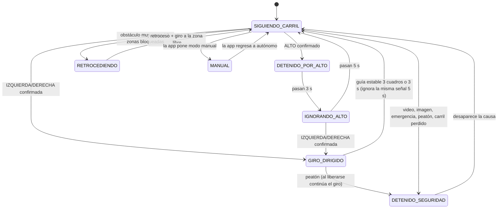

# VisionCar: carrito autónomo (programa de la laptop)

El carrito recorre solo una pista con carril (asfalto negro, orillas blancas, zonas verdes, islas que forman bifurcaciones y línea amarilla punteada). El programa:

- sigue el carril,
- obedece 4 señales (alto, avanzar, izquierda y derecha),
- se detiene ante peatones,
- esquiva obstáculos o retrocede si los tiene muy cerca,
- y registra cada decisión en la nube (API de la carpeta `api/`).

Todas las decisiones se toman en la laptop. La ESP32-CAM transmite el video y obedece los comandos.

```
 ESP32-CAM ──video MJPEG──►  LAPTOP  ──UDP "CLAVE;SEQ;COMANDO;P1;P2"──►  carrito (firmware v2)
                              │  1. PERCIBIR  YOLO (personas/obstáculos) + modelo de señales + carril + OpenCV
                              │  2. RAZONAR   máquina de estados con prioridades
                              │  3. ACTUAR    comando UDP cada 100 ms
                              │  4. NUBE      eventos ──HTTPS──► API  ◄── control manual (app)
 carrito  ───────────────────► "ACK;SEQ"  (sirve para medir la latencia)
```

---

## 1. Archivos

| Archivo | Etapa | Qué hace |
|---|---|---|
| `main.py` | — | Programa principal: une todos los módulos en el ciclo del agente |
| `video.py` | Percibir | Lee el video en un hilo y siempre entrega el cuadro más reciente (stream, webcam o archivo) |
| `percepcion_yolo.py` | Percibir | Modelo propio de señales (`modelo/best.pt`, YOLOv8n) y YOLO COCO para personas (peatón) y 12 clases de obstáculos |
| `carril.py` | Percibir | **Carril híbrido** (línea amarilla o asfalto, bifurcaciones) y **control PD** de las ruedas |
| `percepcion_opencv.py` | Percibir | Calidad de imagen y obstáculos por bordes (sin contar las líneas del carril) |
| `decision.py` | Razonar | **Máquina de estados** con reglas de prioridad |
| `comunicacion.py` | Actuar | Cliente UDP del protocolo v2, ACK, latencia y vigilante |
| `nube.py` | Nube | Envía eventos a la API (cola + `pendientes.jsonl`) y consulta el control manual |
| `interfaz.py` | — | Pantalla y ventanas de calibración |
| `registro.py` | — | CSV de métricas de cada recorrido |
| `analizar_metricas.py` | — | Resumen de un CSV para el reporte |
| `prueba_10.py` | — | Registro de 10 pruebas por señal y porcentaje de éxito |
| `configuracion.py` | — | Carga y guarda `config.json` |
| `config.json` | — | **Todos** los tiempos, umbrales y velocidades |
| `modelo/best.pt` | — | Modelo de señales entrenado (YOLOv8n, imgsz 320; clases alto, avanzar, derecha, izquierda) |
| `.env` | — | Secretos: `CLAVE_UDP` y token de la API (**no se sube a git**) |

---

## 2. Instalación

```bash
python -m venv venv
venv\Scripts\activate          # Windows
pip install -r requirements.txt
```

La nube no necesita paquetes extra (usa la biblioteca estándar de Python).

**Secretos (.env):** copia `.env.example` como `.env` y pon `CLAVE_UDP` (la misma clave que tiene el firmware del carrito) y `TOKEN_CARRITO` (el mismo que está configurado en la API en Render).
La URL de la API está en `config.json → nube.api_url`. También se puede poner `API_URL=...` en `.env`.

**Modelo de señales:** `modelo/best.pt` (YOLOv8n, imgsz 320) con las clases `{0: 'alto', 1: 'avanzar', 2: 'derecha', 3: 'izquierda'}`. Son los mismos nombres del contrato de la API, así que se usan tal cual (sin traducir). Confianza mínima 0.5.
Si tus clases tienen otros nombres, tradúcelas en `config.json → senales → clases`, por ejemplo `"stop": "alto"`.
**Mientras no exista**, el programa funciona igual: muestra *"sin modelo de senales"*, sigue el carril, detecta personas y obstáculos y registra `senal: "ninguna"`. El modelo se carga al iniciar el programa, así que después de copiarlo solo hay que volver a ejecutarlo.

---

## 3. Ejecución

| Comando | Para qué |
|---|---|
| `python main.py` | Carrito real (IP de `config.json`) con nube |
| `python main.py --sin-motores` | **Prueba en la mesa:** video, detección, decisiones y envío a la API, pero **sin** comandos UDP (las ruedas no se mueven) |
| `python main.py --sin-nube` | Carrito real, sin internet |
| `python main.py --webcam --sin-motores --sin-nube` | Prueba con la webcam, sin enviar comandos |
| `python main.py --video pista.mp4 --sin-motores --sin-nube` | Prueba con una grabación (se repite al terminar) |
| `python main.py --webcam --sin-motores --calibrar` | Abre las ventanas de calibración |
| `python main.py --ip 172.20.10.5` | Usar otra IP del carrito |
| `python main.py --sin-yolo` | Sin YOLO COCO (sin personas ni obstáculos por YOLO) |

`--sin-auto` sigue funcionando: es otro nombre de `--sin-motores`.

**Velocidad:** las señales y las personas se analizan en cada cuadro. Si con los dos modelos el programa iría a menos de `yolo.fps_minimo_dos_modelos` (12 FPS), YOLO COCO (personas y obstáculos) corre 1 de cada `yolo.cada_n_cuadros_si_lento` (2) cuadros. El panel lo muestra como *COCO 1/1* o *1/2*.
| `python analizar_metricas.py [--graficas]` | Resumen del último recorrido |
| `python prueba_10.py` | Pruebas de 10 intentos por señal |

Al arrancar, cada modelo YOLO hace una inferencia de "calentamiento" (unos segundos). Así el primer cuadro real no congela el ciclo.

### Teclas

| Tecla | Acción |
|---|---|
| **ESPACIO** | Paro de emergencia (activa/desactiva) |
| **Q** | Salir enviando DETENER varias veces |
| **P** | Pausar el envío UDP (prueba del fail-safe: el carrito debe frenar en 500 ms) |
| **C** | Calibrar asfalto (parche centro-abajo) y amarillo (si se ve) |
| **T** | Abrir/cerrar las ventanas de calibración (trackbars) |
| **K** | Mostrar/ocultar kp, kd, suavizado y la diferencia actual de ruedas |
| **G** | Guardar la configuración actual en `config.json` |

### En pantalla

El estado, el comando y su motivo, la señal vista con barra de confianza (y la señal confirmada), el carril detectado con barra de error, las tres zonas de obstáculos, la conexión a la nube y el modo de control, los eventos pendientes, los FPS, la latencia y los contadores UDP.
Sobre el video se dibujan la región del carril (amarillo = límite izquierdo, blanco = límite derecho, verde = centro), las cajas de YOLO y las zonas.

---

## 4. Protocolo del carrito (firmware v2)

`CLAVE;SEQ;COMANDO;P1;P2` por UDP al puerto 4210 de `172.20.10.3`. La clave compartida con el firmware va en el archivo `.env` como `CLAVE_UDP` (nunca en `config.json` ni en git).

| Comando | Parámetros | Ejemplo |
|---|---|---|
| `AVANZAR`, `RETROCEDER`, `GIRAR_IZQ`, `GIRAR_DER` | vel 0-255 (0 = por defecto) | `CLAVE;12;AVANZAR;160` |
| `DETENER` | — | `CLAVE;13;DETENER` |
| `MOVER` | vel_izq, vel_der (-255 a 255) | `CLAVE;14;MOVER;190;110` |

- `SEQ` empieza en 1 y siempre aumenta. El carrito responde `ACK;SEQ`, y con eso se calcula la latencia de ida y vuelta.
- El comando actual se **reenvía cada 100 ms** (el carrito se detiene solo si pasan 500 ms sin recibir nada).
- **Vigilante:** si el ciclo de visión se traba más de `max_sin_decision_s` (0.5 s), el hilo UDP manda DETENER en lugar de repetir el último comando.
- Si la clave está mal, el carrito no responde y en pantalla aparece *"Carrito no responde (IP o CLAVE?)"*.
- Si tu firmware exige siempre P1 y P2, pon `"rellenar_parametros": true` y se mandará `DETENER;0;0`.

---

## 5. Cómo decide

### 5.1 Prioridades (la primera que se cumple gana)

1. **Seguridad**, inmediata y sin confirmación: video perdido o con más de 1 s de antigüedad, imagen oscura o borrosa, paro de emergencia, persona en el carril → **DETENER**.
2. **Modo manual** desde la app (vía la API) → obedecer la acción manual.
3. **Obstáculo** (12 clases de YOLO COCO + bordes de OpenCV). Depende de `decision.modo_obstaculo`:
   - `"detener"` (el actual): si hay un obstáculo **en el camino** (zona CENTRO y dentro del ROI del carril) → **DETENER**, sin retroceder ni esquivar. Lo que está solo en IZQ o DER no lo detiene. Para seguir, el camino debe estar libre `segundos_libre_para_seguir` (1 s) **seguidos**; luego vuelve a seguir el carril. La pantalla dice **DETENIDO: OBSTACULO** y a la API va `senal: "ninguna"`, `accion: "detener"`.
   - `"esquivar"` (lógica anterior): obstáculo muy cercano o tres zonas bloqueadas → retroceder y girar hacia la zona más libre.
4. Solo con `"esquivar"`: **obstáculo en una zona** → girar hacia la zona más libre.
5. **Señal activa** o maniobra en curso, en este orden: **alto > giros > avanzar**. Si se ven dos señales a la vez gana la de mayor prioridad, y un alto corta un giro en curso. Si un obstáculo interrumpe un alto o un giro, la maniobra sigue al quitarse el obstáculo (si aún le queda tiempo).
6. **Seguir el carril** (control PD → `MOVER`).

En resumen: **peatón > obstáculo > alto > giros > avanzar > carril** (la seguridad y el modo manual de la app van antes que todo).

**Señal activa (confirmada):** la misma clase aparece en **3 cuadros seguidos** (`cuadros_seguidos_senal`) con confianza ≥ `umbral_confianza_senal` (0.5) y **cerca**: el alto de su recuadro es mayor que `altura_activacion_senal` (0.25 = 25 % de la altura de la imagen). Un cuadro sin la señal rompe la racha (evita falsos positivos).

| Señal | Qué hace |
|---|---|
| `alto` | DETENER `tiempo_alto_s` (3 s), luego sigue el carril. Ignora otro alto `tiempo_ignorar_alto_s` (5 s) |
| `izquierda` / `derecha` | **GIRO_DIRIGIDO** (máx. `giro_dirigido_max_s` = 3 s): gira `giro_tiempo_s` (0.8 s), luego sigue **solo la orilla de ese lado** (ORILLA-I / ORILLA-D) ignorando la guía y las bifurcaciones del otro lado; regresa a LINEA cuando ve la guía estable (`giro_linea_cuadros_estable` = 3 cuadros con \|error\| < `giro_linea_error_max` = 0.3) o al pasar el máximo. Un peatón u obstáculo lo pausa y al liberarse continúa. Ignora **la misma** señal `tiempo_ignorar_giro_s` (5 s) |
| `avanzar` | Sigue el carril; durante `avanzar_recto_s` (3 s), en una bifurcación toma el tramo más al centro (el más recto) |
| `peaton` (persona COCO) | DETENER mientras la persona esté en el camino |
| sin señal | Sigue el carril |
Las detecciones de más de `ventana_confirmacion_s` (1.5 s) ya no cuentan, y las señales que se están ignorando no se acumulan.

**Persona en el carril:** su caja se cruza con el carril detectado (más un margen), o su área es mayor que `area_persona_grande`. Si no hay carril, se usa la zona central.

### 5.2 Máquina de estados



Desde **cualquier** estado se pasa a DETENIDO_SEGURIDAD (regla 1) o a MANUAL (regla 2). En ambos casos se cancela la maniobra en curso.

### 5.3 Seguimiento de carril HÍBRIDO (`carril.py`)

Pista: asfalto negro (gris oscuro en cámara), orillas blancas, zonas verdes fuera del camino, islas verdes con borde blanco (bifurcaciones) y línea amarilla punteada.

**A) Modo LINEA (prioridad, solo si `usar_linea_amarilla` es `true`; hoy `false` porque la pista aún no tiene línea).** Con **C** el amarillo solo se calibra si el tono medido está entre H 15 y 35. En la ROI (`roi_inicio_y`) se busca amarillo (`amarillo_bajo/alto`) en `franjas_linea` franjas: un punto por franja. Como la línea es punteada, se juntan con los puntos de los últimos `memoria_linea_s` (0.5 s) y se ajusta una recta (`grado_ajuste_linea` = 2 para curva). Objetivo según `modo_linea`: `"carril_derecho"` = línea + `offset_carril` × ancho (0.25), `"sobre_linea"` = la línea.

**Modo `solo_linea: true` (actual).** Fuera de un GIRO_DIRIGIDO nunca se cambia a ORILLA ni ASFALTO. Si la guía deja de verse, se sigue la última recta ajustada (`LINEA-PRED`) durante `tiempo_prediccion_linea_s` (1.5 s) con base `velocidad_sin_linea` (115); después **DETENER** con `LINEA PERDIDA` (sin girar a ciegas). Los cuadros con brillo < `calidad_imagen.brillo_cuadro_vacio` (15) se ignoran (se repite el último comando y no cuentan como tiempo sin línea), hasta `max_cuadros_vacios_s` (1 s) seguidos. El CSV guarda `memoria_linea` (segundos sin ver la guía). Con `false` funciona el orden LINEA > ORILLA > ASFALTO de abajo.

**B0) Modo ORILLA (por defecto sin amarillo; orden LINEA > ORILLA > ASFALTO).** El camino es más ancho que la imagen, así que se sigue la orilla blanca. En cada una de las `franjas_asfalto` franjas se busca, desde el centro hacia la derecha (y hacia la izquierda), la primera transición asfalto → blanco. Error por franja = (x_orilla − x_objetivo) / medio ancho, con `objetivo_orilla_der` / `objetivo_orilla_izq` (fracción del ancho, se calibran con **C**). Se usan los mismos `pesos_franjas`, el suavizado y el PD. Lado: `lado_orilla` (`"derecha"`), o el de la señal izquierda/derecha activada en los últimos 4 s. Si del centro al borde de la imagen todo es asfalto (sin blanco), la orilla está **fuera de imagen**: x = 1 + `margen_fuera` (0.05) a la derecha o 0 − `margen_fuera` a la izquierda (triángulo rojo en el borde); cuenta como vista. Si la orilla elegida se ve en menos de `min_franjas_orilla` (2) franjas se usa la otra (`ORILLA-I`/`ORILLA-D`); si ninguna, ASFALTO.

**B) Modo ASFALTO (respaldo, sin amarillo ni orillas).** Camino = oscuro y poco saturado (`asfalto_bajo/alto`), sin verde (`verde_bajo/alto`) ni blanco; las orillas blancas separan tramos. La ROI se divide en `franjas_asfalto` (5); en cada franja se toma el tramo conectado al de abajo (en la de abajo, donde está el carrito o el más cercano) y su centro. Error = promedio ponderado (más peso abajo).

**Común:**
- **error** = promedio de los objetivos por franja con `pesos_franjas` (de abajo hacia arriba `[0.40, 0.30, 0.20, 0.10, 0.0]`: la más lejana no cuenta), normalizado de −1 a +1. Se suaviza con un promedio exponencial (`suavizado_error` = 0.4). **PD:** diferencia de ruedas = 2·(kp·error + kd·Δerror/Δt), limitada a ±`max_diferencia_ruedas` (70) y sin cambiar más de `max_cambio_por_cuadro` (25) por cuadro; `vel = velocidad_base (170) ± diferencia/2`. Ninguna rueda baja de `velocidad_rueda_min` (110, como el firmware): si una quedaría abajo, se suben las dos para conservar el giro. **Curvas:** al error se le suma `k_angulo` (0.5) × ángulo de la recta de la guía (anticipación, solo en LINEA/LINEA-PRED) y una integral pequeña (`ki` 0.15, límite ±`limite_integral` 0.3, se reinicia al cambiar de signo el error o al detenerse). Si |error de control| > `umbral_giro_cerrado` (0.35) la rueda interior puede bajar hasta 0 y la exterior va al menos a `vel_exterior_min_giro` (140), con |dif| ≤ `max_diferencia_giro_cerrado` (160); si > `umbral_pivote` (0.6) la interior puede ir en reversa hasta −`vel_reversa_pivote` (120), con |dif| ≤ `max_diferencia_pivote` (260). Fuera de esos casos rige el mínimo de 110. **Imagen borrosa** en movimiento no detiene: se mantiene el último comando hasta `calidad_imagen.max_borrosa_s` (1 s). El CSV guarda `angulo_linea`, `termino_i`, `rueda_izq`, `rueda_der`.
- **Bifurcación** (una franja con dos tramos conectados, separados por una ISLA real: un hueco de al menos `min_ancho_isla` = 15 % del ancho con verde o blanco; con `isla_requiere_blanco: true`, solo con blanco. Las manchas dentro del asfalto cuentan como asfalto): si en los últimos `ventana_giro_bifurcacion_s` (4 s) se activó `izquierda`/`derecha`, se toma ese tramo; si no, `preferencia_bifurcacion` (`"derecha"`). En modo LINEA solo cuentan los puntos amarillos de esa rama.
- **Peatón y obstáculos solo en la pista** (`decision.solo_en_pista`): una detección de YOLO solo cuenta si el punto medio de abajo de su recuadro (los pies) está sobre asfalto (cuadrito de `radio_pies_px`) y en la mitad de abajo de la imagen (`altura_minima_pies` = 0.5). Si no, se ignora y se dibuja en gris como "fuera de pista".
- **Carril perdido** (sin amarillo y menos de `min_fraccion_asfalto` = 15 % de la ROI es asfalto): **DETENER**. Si hay asfalto pero no se pudo seguir, aplica `max_cuadros_sin_carril` / `al_perder_carril` como antes.
- En pantalla: máscara de asfalto (azul), tramo elegido por franja, puntos amarillos (llenos = este cuadro, huecos = memoria), recta ajustada (naranja), objetivos (cruces verdes) y la etiqueta `LINEA`/`ASFALTO`/`PERDIDO` con el error, % de asfalto y la rama en bifurcaciones.

### 5.4 Nube (`nube.py`)

- Se manda un evento en cada **cambio de acción o señal** y **cada 2 s**, con un mínimo de 0.25 s entre eventos para no saturar la API.
  Formato exacto: `{"carrito_id","fecha","senal","confianza","accion","modo"}`.
- El retroceso se registra como `"detener"`. La API rechaza campos extra, así que el motivo "retroceso" solo queda en el CSV local.
- **Sin internet:** los eventos van a `pendientes.jsonl` y se suben en lotes al volver la conexión (reintento cada 5 s). Los eventos que la API rechace por inválidos (422) van a `rechazados.jsonl`.
- **Control:** `GET /api/v1/control/{carrito_id}` cada 300 ms. Si `modo = "manual"`, el carrito obedece la acción. Si no hay respuesta en 1 s estando en manual, se detiene.
- Todo corre en hilos con cola: la nube **nunca** frena el ciclo de visión.

---

## 6. Calibración

**Tecla C (automática):** pon el carrito en el asfalto, con el centro-abajo de la imagen sobre asfalto limpio (sin línea ni orilla) y, si puedes, con la línea amarilla visible en la ROI. Presiona **C** con el carrito **centrado en una recta**: guarda la posición de las orillas vistas, corrida `margen_calibracion_orilla` (0.04) hacia el centro, como `objetivo_orilla_der/izq` (máximo 0.92 a la derecha, mínimo 0.08 a la izquierda; las franjas con la orilla fuera de imagen se quedan igual), toma los umbrales del asfalto de ese parche (`parche_calibracion` = 20 % del ancho × 15 % de alto) y los del amarillo de lo que vea en la ROI. El resultado sale en pantalla y en la consola; revisa que la máscara azul cubra el camino y no el verde. **G** lo guarda en `config.json`.

**Trackbars (`--calibrar` o tecla T):** ajuste fino a mano.

**Ventana "Calibracion carril"**: asfalto en gris, verde en verde, orillas en blanco y línea en amarillo. Rayas azules = tramo de asfalto elegido, puntos rojos = puntos amarillos, puntos verdes = objetivo.
1. Coloca el carrito centrado en su carril.
2. `ROI inicio %`: que la región cubra solo la pista cercana.
3. `Blanco V min` / `Blanco S max`: que las orillas blancas queden completas. `Asfalto S max / V min / V max` y `Verde S min`: en la ventana, el asfalto gris, el pasto verde y nada del pasto en gris.
4. `Amar H min/max`, `S min`, `V min`: que solo la línea amarilla se pinte de amarillo.
5. `Offset carril %`: dónde va el carrito respecto a la línea amarilla en `"carril_derecho"`.
6. Revisa en la ventana principal que el error sea ≈ 0 con el carrito centrado. Si la cámara no está centrada, ajusta `centro_objetivo` en `config.json`.
7. **Control PD:** empieza con `Kd = 0` y una `Vel base` baja. Sube `Kp` hasta que corrija sin zigzaguear, y luego sube `Kd` para amortiguar las oscilaciones.
8. Guarda con **G** o moviendo `GUARDAR (1)` a 1.

**Ventana "Calibracion obstaculos"**: con la pista vacía, la máscara debe quedar negra. Si no, sube `Canny`, `Area min cont` u `Ocupacion %`. Ahí también se ajustan `Brillo min`, `Nitidez min` (una pista oscura puede pasar por "imagen oscura") y `Conf YOLO %`.

**Señales (en `config.json`)**: pon la señal a la distancia a la que quieres que reaccione y mira el `h..%` que aparece junto a su recuadro (alto del recuadro / alto de la imagen). Usa ese valor como `altura_activacion_senal`; cuando se supera, el recuadro dice **CERCA**. Calibra `giro_izquierda` / `giro_derecha` ([vel_izq, vel_der]) y `giro_tiempo_s` en la intersección real. (`preparacion_tiempo_s` > 0 haría que siga el carril unos segundos antes de girar; hoy es 0.)
Para usar distancia en lugar de tiempo: `preparacion_distancia_cm` > 0 y `velocidad_estimada_cm_s` (mídela: cm recorridos en 1 s a la velocidad base).

---

## 7. Parámetros principales de `config.json`

| Sección | Parámetros |
|---|---|
| `auto` | `ip`, `puerto_udp`, `puerto_stream`, `ruta_stream` |
| `video` | tamaño de trabajo y `max_antiguedad_cuadro_s` (1 s) |
| `yolo` | modelo COCO, `cada_n_cuadros`, `cada_n_cuadros_si_lento`, `fps_minimo_dos_modelos`, `clases_persona`, `clases_obstaculo` |
| `senales` | `modelo` (modelo/best.pt), `imgsz`, `confianza` (0.5), `cada_n_cuadros` |
| `carril` | `modo_linea`, `offset_carril`, `memoria_linea_s`, rangos HSV (amarillo, blanco, asfalto, verde), `franjas_linea`, `franjas_asfalto`, `preferencia_bifurcacion`, `min_fraccion_asfalto`, `kp`, `kd`, `velocidad_base`, límites de rueda |
| `opencv_obstaculos` | ROI, Canny, `umbral_ocupacion_zona`, `margen_lineas_carril` |
| `decision` | señales (`umbral_confianza_senal`, `cuadros_seguidos_senal`, `altura_activacion_senal`), alto (`tiempo_alto_s`, `tiempo_ignorar_alto_s`), giros (preparación, `giro_izquierda/derecha`, `giro_tiempo_s`, `giro_dirigido_max_s`, `giro_linea_cuadros_estable`, `giro_linea_error_max`, `tiempo_ignorar_giro_s`), `avanzar_recto_s`, obstáculos (`modo_obstaculo` = `"detener"` o `"esquivar"`, `segundos_libre_para_seguir`, áreas, retroceso, esquive), carril perdido (`max_cuadros_sin_carril`, `al_perder_carril`, búsqueda), `esperar_senal_avanzar_al_iniciar` |
| `velocidades` | velocidad de AVANZAR/GIRAR/RETROCEDER (modo manual) |
| `comunicacion` | `intervalo_envio_s`, `max_sin_decision_s`, `rellenar_parametros` |
| `nube` | `api_url`, `carrito_id`, intervalos, timeouts, archivos de pendientes |

---

## 8. Pruebas y métricas

- `python prueba_10.py`: para cada señal pide 10 intentos (`s` = éxito, `n` = fallo, `r` = repetir, `q` = terminar) con nota opcional. Guarda `pruebas/pruebas_*.csv` y muestra la tabla de % de éxito.
  `--incluir-seguridad` agrega peatón y obstáculo, `--continuar archivo.csv` retoma una sesión y `--resumen archivo.csv` solo calcula los porcentajes.
- Cada ejecución de `main.py` crea `registros/recorrido_*.csv` con estado, comando, motivo, regla, señal, confianza, error de carril, zonas, nube y pendientes.
  `python analizar_metricas.py` muestra FPS, latencia, cuadros por estado, acciones, reglas, señales, % de carril detectado y error promedio.

---

## 9. Problemas comunes

| Síntoma | Solución |
|---|---|
| "Carrito no responde (IP o CLAVE?)" | Revisa la IP (172.20.10.3), `CLAVE_UDP` en `.env` y el firewall de Windows (permitir Python en redes privadas) |
| "SIN VIDEO" | Abre `http://IP:81/stream` en el navegador y ciérralo antes de ejecutar: la ESP32 admite un solo cliente |
| Se detiene por "Imagen muy oscura" | La pista es oscura: baja `brillo_minimo` |
| Zigzaguea | Baja `kp`, sube `kd` o baja `velocidad_base` |
| No toma las curvas | Sube `kp` o `velocidad_rueda_max`, o permite una rueda negativa (`velocidad_rueda_min`) |
| Confunde las líneas | Recalibra HSV; con reflejos usa `"metodo": "color"` |
| Frena ante un objeto que no está | Sube `umbral_ocupacion_zona` / `area_minima_contorno` |
| No ve un objeto oscuro sobre la pista oscura | Es una limitación de los bordes: lo cubre YOLO si la clase está en `clases_obstaculo` |
| Objetos amarillos o blancos no se ven por bordes | Se confunden con las líneas del carril y se borran; YOLO sigue detectándolos |
| "token rechazado (401/403)" | Revisa `TOKEN_CARRITO` en `.env` |
| Pendientes no bajan | No hay conexión o la API está dormida (Render gratis tarda ~1 min en despertar) |
