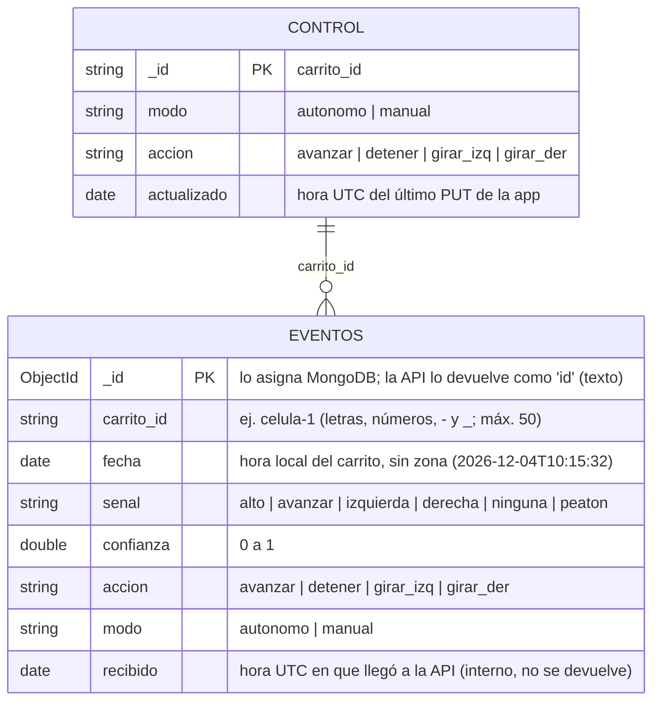

# Diagrama de la base de datos (MongoDB Atlas)

Base de datos: `visioncar` · Colecciones: `eventos` y `control`.



## Índices de `eventos`

| Nombre | Campos | Para qué |
|---|---|---|
| `_id_` | `_id` | Automático de MongoDB |
| `idx_carrito_fecha` | `carrito_id` ↑, `fecha` ↓ | Historial y último evento de un carrito |
| `idx_fecha` | `fecha` ↓ | Historial de todos los carritos y filtros `desde`/`hasta` |
| `idx_senal_fecha` | `senal` ↑, `fecha` ↓ | Filtro por señal |
| `idx_carrito_confianza` | `carrito_id` ↑, `confianza` ↑ | Evento de menor confianza en estadísticas |

Los índices se crean solos cuando arranca la API.
La colección `control` solo usa el índice automático de `_id` (hay un documento por carrito).

## Ejemplo de documento en `eventos`

```json
{
  "_id": {"$oid": "675012ab34cd56ef7890abcd"},
  "carrito_id": "celula-1",
  "fecha": {"$date": "2026-12-04T10:15:32.000Z"},
  "senal": "alto",
  "confianza": 0.93,
  "accion": "detener",
  "modo": "autonomo",
  "recibido": {"$date": "2026-12-04T16:15:33.120Z"}
}
```

> En Atlas, `fecha` aparece con "Z" porque MongoDB siempre muestra las fechas así, pero el valor es la hora local del carrito (10:15:32). `recibido` sí es UTC.
