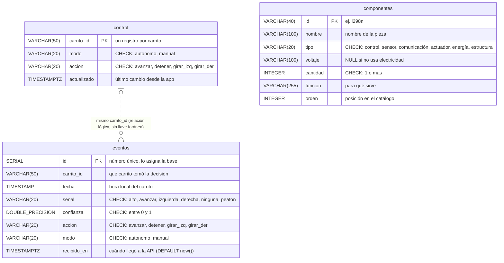

# Base de datos de VisionCar en PostgreSQL (Supabase)

Materia: **Bases de Datos en la Nube**. La API del carrito autónomo guarda sus datos en una base **PostgreSQL** alojada en **Supabase** (un servicio en la nube). La API crea las tablas sola al arrancar; el SQL completo está en [sql/esquema.sql](sql/esquema.sql).

## Diagrama entidad-relación

**Cómo leer las relaciones.** Un carrito puede tener **muchos** eventos y **a lo más un** registro de control. Las dos tablas se unen por la columna `carrito_id`, pero **no** hay llave foránea (por eso la línea es punteada): no existe una tabla `carritos`, y el carrito debe poder guardar eventos aunque la app nunca le haya mandado una orden. `componentes` es un catálogo independiente: describe las piezas del carrito y no se relaciona con las otras tablas.

## Tabla `eventos`

Cada vez que el carrito ve una señal y decide qué hacer, se guarda **una fila**. Es la tabla que más crece.

| Columna | Tipo | Qué guarda |
|---|---|---|
| `id` | `SERIAL` (llave primaria) | Número que la base asigna sola (1, 2, 3…). Identifica cada evento; la API lo entrega como texto (`"1532"`). |
| `carrito_id` | `VARCHAR(50)` | Nombre del carrito que tomó la decisión, ej. `celula-1`. Solo letras, números, `-` y `_`. |
| `fecha` | `TIMESTAMP(3)` | Momento de la decisión en la **hora local del carrito**, sin zona horaria, con milisegundos. |
| `senal` | `VARCHAR(20)` | Señal que vio la cámara: `alto`, `avanzar`, `izquierda`, `derecha`, `ninguna` o `peaton`. |
| `confianza` | `DOUBLE PRECISION` | Qué tan seguro estaba el modelo de visión, de 0 a 1 (ej. `0.93` = 93 %). |
| `accion` | `VARCHAR(20)` | Lo que hizo el carrito: `avanzar`, `detener`, `girar_izq` o `girar_der`. |
| `modo` | `VARCHAR(20)` | Si manejaba solo (`autonomo`) o lo controlaba la app (`manual`). |
| `recibido_en` | `TIMESTAMPTZ` | Fecha y hora (con zona) en que el evento **llegó** a la API. La pone la base (`DEFAULT now()`). Sirve para saber si el carrito los mandó tarde (por ejemplo, si estuvo sin internet). |

**Restricciones `CHECK`:** la base rechaza cualquier valor fuera del contrato (una señal inventada, una confianza de 1.5, etc.). La API ya los valida antes, pero así la base protege los datos aunque alguien escriba directo en ella.

**Índices** (hacen rápidas las consultas, como el índice de un libro):
- `idx_eventos_carrito_fecha (carrito_id, fecha DESC)`: historial de un carrito del más reciente al más antiguo.
- `idx_eventos_fecha (fecha DESC)`: historial de todos los carritos y filtros `desde` / `hasta`.

## Tabla `control`

Guarda la orden que la app móvil le da a cada carrito. Hay **una sola fila por carrito**: cada vez que la app manda una orden, la fila se **actualiza** (no se agrega otra). El carrito la consulta cada 300 ms.

| Columna | Tipo | Qué guarda |
|---|---|---|
| `carrito_id` | `VARCHAR(50)` (llave primaria) | El carrito al que va dirigida la orden. Por ser llave primaria no se puede repetir. |
| `modo` | `VARCHAR(20)` | `autonomo` (el carrito decide) o `manual` (obedece a la app). |
| `accion` | `VARCHAR(20)` | La acción manual: `avanzar`, `detener`, `girar_izq` o `girar_der`. |
| `actualizado` | `TIMESTAMPTZ` | Cuándo mandó la app la última orden. Si en modo manual pasan más de 2 segundos sin una orden nueva, la API le dice al carrito `detener` por seguridad. |

Si un carrito no tiene fila en esta tabla, la API responde modo `autonomo`.

## Tabla `componentes`

Catálogo de las piezas físicas del carrito. La API **solo lee** esta tabla. La primera vez (cuando está vacía) se llena con el archivo `app/datos/componentes.json`.

| Columna | Tipo | Qué guarda |
|---|---|---|
| `id` | `VARCHAR(40)` (llave primaria) | Nombre corto de la pieza, ej. `esp32cam`, `l298n`. |
| `nombre` | `VARCHAR(100)` | Nombre completo, ej. *Driver de motores L298N*. |
| `tipo` | `VARCHAR(20)` | Categoría: `control`, `sensor`, `comunicación`, `actuador`, `energía` o `estructura`. |
| `voltaje` | `VARCHAR(100)` | Voltaje de trabajo como texto (ej. `3.3 V`). Es `NULL` en piezas sin electricidad, como el chasis. |
| `cantidad` | `INTEGER` | Cuántas lleva el carrito (mínimo 1). |
| `funcion` | `VARCHAR(255)` | Para qué sirve en el carrito. |
| `orden` | `INTEGER` | Posición en el catálogo. Es interna: sirve para que la API devuelva las piezas en el mismo orden que el JSON y no se muestra a 4°A. |

## Conceptos usados

- **Llave primaria (PK):** columna que identifica cada fila sin repetirse (`id`, `carrito_id`).
- **`SERIAL`:** número entero que la base aumenta sola en cada fila nueva.
- **`CHECK`:** regla que cada fila debe cumplir; si no, la base la rechaza.
- **Índice:** estructura extra que acelera las búsquedas por esas columnas.
- **`TIMESTAMP` vs `TIMESTAMPTZ`:** el primero guarda la fecha tal cual (hora local del carrito); el segundo guarda un instante exacto con zona horaria (útil para comparar con la hora del servidor).
- **`NULL`:** “no hay dato” (no es lo mismo que 0 o texto vacío).
